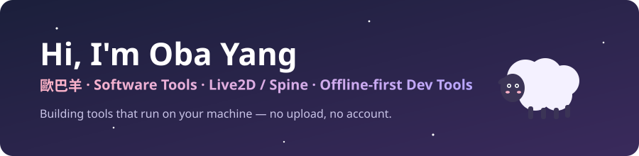

 

[**obayang.com**](https://obayang.com) · [Hire me](https://obayang.com/#contact) · **English** · [繁體中文](#繁體中文)

### About me

- I build **software and developer tools**: file viewers, editors, converters and CLIs
- I work a lot with **Spine** skeletal animation and **Live2D / VTuber** models
- I make **offline-first web tools** that run entirely in your browser, so nothing you paste leaves your machine
- I am available for freelance work. See [obayang.com](https://obayang.com) for services and pricing

### Featured projects

<table>
<tr>
<td width="50%" valign="top">

#### [Spine Asset Inspector](https://github.com/zzoraemon043/spine-asset-inspector)
Preview, debug and export Spine 2D animations in the browser: mix lab, skins, debug overlays, atlas unpacking, PNG / sprite sheet / WebM export.

`React` `TypeScript` `WebGL` · [**Live demo**](https://zzoraemon043.github.io/spine-asset-inspector/)

</td>
<td width="50%" valign="top">

#### [hexsleuth](https://github.com/zzoraemon043/hexsleuth)
Hand an AI agent a few sample files and get back the format: a specification, a Kaitai Struct definition, a parser and tests, each backed by evidence.

`TypeScript` `MCP` · [**npm**](https://www.npmjs.com/package/hexsleuth)

</td>
</tr>
<tr>
<td width="50%" valign="top">

#### [zhtw-guard](https://github.com/zzoraemon043/zhtw-guard)
Finds Simplified characters, Mainland terms and encoding problems in code, docs and AI agent replies. CLI, GitHub Action and agent hooks.

`TypeScript` `CLI` · [**npm**](https://www.npmjs.com/package/zhtw-guard)

</td>
<td width="50%" valign="top">

#### [Dev Workbench](https://github.com/zzoraemon043/dev-workbench)
One offline tab for JSON, Regex, JWT, Diff, encoder pipelines and WebSocket debugging.

`React` `TypeScript` · [**Live demo**](https://zzoraemon043.github.io/dev-workbench/)

</td>
</tr>
<tr>
<td width="50%" valign="top">

#### [sqlpane](https://github.com/zzoraemon043/sqlpane)
Drop in CSV, Excel, Parquet, SQLite or a MySQL / SQL Server dump and query it with SQL, offline in the browser on DuckDB-WASM.

`TypeScript` `DuckDB` · [**Live demo**](https://zzoraemon043.github.io/sqlpane/)

</td>
<td width="50%" valign="top">

#### [Web Mock Studio](https://github.com/zzoraemon043/web-mock-studio)
Mock any API in your browser with a Service Worker, synthesize JSON Schema from samples, turn cURL into mock rules.

`TypeScript` `Service Worker` · [**Live demo**](https://zzoraemon043.github.io/web-mock-studio/)

</td>
</tr>
<tr>
<td width="50%" valign="top">

#### [layerdesk](https://github.com/zzoraemon043/layerdesk)
Open a PSD in the browser, move, scale, rotate and group its layers, save it back. Includes a rigging check for Live2D and Spine.

`React` `TypeScript` `Canvas` · [**Live demo**](https://zzoraemon043.github.io/layerdesk/)

</td>
</tr>
</table>

### Open source contributions

- [EasyLive2D/live2d-py#149](https://github.com/EasyLive2D/live2d-py/pull/149) (merged): fix a silent crash when a Live2D model's texture is missing (OpenGL backend)
- [CherryHQ/cherry-studio#21954](https://github.com/CherryHQ/cherry-studio/pull/21954) (merged): stop CJK text files from being detected as binary
- [dexie/Dexie.js#2353](https://github.com/dexie/Dexie.js/pull/2353) (merged): ignore errors from aborted liveQuery runs after unsubscribe
- [Kitware/vtk-js#3687](https://github.com/Kitware/vtk-js/pull/3687) (merged): fix errors in the KeyboardCameraManipulator example
- [holistics/dbml#1009](https://github.com/holistics/dbml/pull/1009) (merged): keep the written order of index columns when parsing
- [ThatOpen/engine_components#835](https://github.com/ThatOpen/engine_components/pull/835) (merged): type FragmentsManager.init options correctly
- [ormar-orm/ormar#1865](https://github.com/ormar-orm/ormar/pull/1865) (merged): make get() after exclude() report multiple matches
- [greggman/twgl.js#246](https://github.com/greggman/twgl.js/pull/246) (merged): emit declare namespace for v3, m4 and primitives in the TypeScript definitions
- [pycollada/pycollada#166](https://github.com/pycollada/pycollada/pull/166) (merged): drop XML comments and processing instructions when parsing COLLADA files with lxml
- [dcmjs-org/dcmjs#610](https://github.com/dcmjs-org/dcmjs/pull/610) (merged): format DS numbers to 16 characters instead of cutting off the exponent
- [AlaSQL/alasql#2602](https://github.com/AlaSQL/alasql/pull/2602) (merged): key the statement cache on the SQL text instead of its hash
- [moeru-ai/airi#3026](https://github.com/moeru-ai/airi/pull/3026) (merged): load the Kokoro TTS model in the window that generates speech

### Special contributions

Private repositories; the links are only visible to collaborators.

- [vtxe02023274/aicl-v113#12](https://github.com/vtxe02023274/aicl-v113/pull/12) (merged): fix compile errors in the server submodules (86 errors, lost generics and final reassignments)
- [vtxe02023274/aicl-v113#13](https://github.com/vtxe02023274/aicl-v113/pull/13) (merged): fix compile errors in server/ui (71 errors, lost generics and a shadowed package name)
- [vtxe02023274/aicl-v113#14](https://github.com/vtxe02023274/aicl-v113/pull/14) (merged): fix compile errors in scripting and database (64 errors)
- [vtxe02023274/aicl-v113#15](https://github.com/vtxe02023274/aicl-v113/pull/15) (merged): fix compile errors in aicl, Apple, acemod and JsonAndHttps (69 errors)
- [vtxe02023274/aicl-v113#16](https://github.com/vtxe02023274/aicl-v113/pull/16) (merged): fix compile errors in tools (124 errors, including the expression tokenizer and packet builders)
- [vtxe02023274/aicl-v113#28](https://github.com/vtxe02023274/aicl-v113/pull/28) (merged): drop 5 stray javax/annotation classes and the last warnings; the class list now matches the original build
- [vtxe02023274/aicl-v113#29](https://github.com/vtxe02023274/aicl-v113/pull/29) (merged): trace the bugs kept from the original build back to the original bytecode
- [vtxe02023274/aicl-v113#31](https://github.com/vtxe02023274/aicl-v113/pull/31) (merged): add a 43-item in-game test checklist against the original server
- [vtxe02023274/VanitasShield-v113#4](https://github.com/vtxe02023274/VanitasShield-v113/pull/4) (merged): ijl15 proxy DLL forwarding all 6 exports to the genuine library by ordinal
- [vtxe02023274/VanitasShield-v113#5](https://github.com/vtxe02023274/VanitasShield-v113/pull/5) (merged): API hook framework on Microsoft Detours with install/remove in one transaction and a log file
- [vtxe02023274/VanitasShield-v113#6](https://github.com/vtxe02023274/VanitasShield-v113/pull/6) (merged): verify the rebuilt launcher against the original in 5 scenarios and fix a message mismatch

### Tech stack

---

## 繁體中文

### 關於我

- 開發**軟體與開發者工具**：檔案檢視器、編輯器、轉檔工具與命令列工具
- 常和 **Spine** 骨架動畫、**Live2D／VTuber** 模型打交道
- 做**離線優先的網頁工具**：全部在瀏覽器裡執行，貼進去的東西不會離開你的電腦
- 開放接案，服務與價格請見 [obayang.com](https://obayang.com)

### 作品

| 專案 | 說明 |
|---|---|
| [Spine Asset Inspector](https://github.com/zzoraemon043/spine-asset-inspector) | 在瀏覽器檢視、除錯、匯出 Spine 動畫：混合測試、Skin 組合、除錯疊圖、圖集拆解、PNG／序列幀／WebM 匯出（[線上試用](https://zzoraemon043.github.io/spine-asset-inspector/)） |
| [hexsleuth](https://github.com/zzoraemon043/hexsleuth) | 讓 AI 從樣本檔推導二進位檔案格式，產出規格書、Kaitai Struct 定義、解析程式與測試（[npm](https://www.npmjs.com/package/hexsleuth)） |
| [zhtw-guard](https://github.com/zzoraemon043/zhtw-guard) | 找出程式碼、文件與 AI 回覆中混入的簡體字、大陸用語與編碼問題（[npm](https://www.npmjs.com/package/zhtw-guard)） |
| [Dev Workbench](https://github.com/zzoraemon043/dev-workbench) | 一個分頁搞定 JSON、正規表達式、JWT、文字比對、編碼轉換與 WebSocket 除錯（[線上試用](https://zzoraemon043.github.io/dev-workbench/)） |
| [sqlpane](https://github.com/zzoraemon043/sqlpane) | 拖進 CSV、Excel、Parquet、SQLite 或 MySQL／SQL Server 匯出檔，直接用 SQL 查詢，離線在瀏覽器執行（[線上試用](https://zzoraemon043.github.io/sqlpane/)） |
| [layerdesk](https://github.com/zzoraemon043/layerdesk) | 在瀏覽器打開 PSD，拖曳、縮放、旋轉、整理圖層後存回 PSD，並檢查匯入 Live2D／Spine 前的拆件問題（[線上試用](https://zzoraemon043.github.io/layerdesk/)） |
| [Web Mock Studio](https://github.com/zzoraemon043/web-mock-studio) | 在瀏覽器裡模擬 API、從範例反推 JSON Schema、cURL 轉模擬規則（[線上試用](https://zzoraemon043.github.io/web-mock-studio/)） |

### 開源貢獻

- [EasyLive2D/live2d-py#149](https://github.com/EasyLive2D/live2d-py/pull/149)（已合併）：修正 Live2D 模型缺少貼圖時無聲閃退的問題
- [CherryHQ/cherry-studio#21954](https://github.com/CherryHQ/cherry-studio/pull/21954)（已合併）：修正中日韓文字檔被誤判為二進位檔的問題
- [dexie/Dexie.js#2353](https://github.com/dexie/Dexie.js/pull/2353)（已合併）：修正 liveQuery 取消訂閱後，被中止的查詢仍丟出錯誤
- [Kitware/vtk-js#3687](https://github.com/Kitware/vtk-js/pull/3687)（已合併）：修正鍵盤控制 3D 相機範例執行時報錯
- [holistics/dbml#1009](https://github.com/holistics/dbml/pull/1009)（已合併）：修正解析資料庫索引時欄位順序被打亂
- [ThatOpen/engine_components#835](https://github.com/ThatOpen/engine_components/pull/835)（已合併）：修正 BIM 3D 引擎初始化參數的型別定義
- [ormar-orm/ormar#1865](https://github.com/ormar-orm/ormar/pull/1865)（已合併）：修正 Python ORM 用排除條件查詢時，多筆結果沒有回報錯誤
- [greggman/twgl.js#246](https://github.com/greggman/twgl.js/pull/246)（已合併）：修正 WebGL 函式庫的 TypeScript 型別定義，讓 v3、m4 等模組可以正常引用
- [pycollada/pycollada#166](https://github.com/pycollada/pycollada/pull/166)（已合併）：修正 3D 模型格式 COLLADA 檔案含註解時讀取失敗
- [dcmjs-org/dcmjs#610](https://github.com/dcmjs-org/dcmjs/pull/610)（已合併）：修正醫療影像 DICOM 檔案寫入小數時，科學記號的指數被截掉
- [AlaSQL/alasql#2602](https://github.com/AlaSQL/alasql/pull/2602)（已合併）：修正 JavaScript SQL 資料庫快取碰撞，兩句不同的 SQL 會拿到同一個結果
- [moeru-ai/airi#3026](https://github.com/moeru-ai/airi/pull/3026)（已合併）：修正 AI 虛擬角色桌面版在設定視窗試聽 Kokoro 語音時報錯

### 特殊貢獻

私人倉庫，連結只有協作者能開啟。

- [vtxe02023274/aicl-v113#12](https://github.com/vtxe02023274/aicl-v113/pull/12)（已合併）：修正 server 子模組編譯錯誤（86 個，泛型遺失與 final 變數重新指派）
- [vtxe02023274/aicl-v113#13](https://github.com/vtxe02023274/aicl-v113/pull/13)（已合併）：修正 server/ui 編譯錯誤（71 個，泛型遺失與套件名被同名欄位遮蔽）
- [vtxe02023274/aicl-v113#14](https://github.com/vtxe02023274/aicl-v113/pull/14)（已合併）：修正 scripting、database 編譯錯誤（64 個）
- [vtxe02023274/aicl-v113#15](https://github.com/vtxe02023274/aicl-v113/pull/15)（已合併）：修正 aicl、Apple、acemod、JsonAndHttps 編譯錯誤（69 個）
- [vtxe02023274/aicl-v113#16](https://github.com/vtxe02023274/aicl-v113/pull/16)（已合併）：修正 tools 編譯錯誤（124 個，含運算式解析器與封包組裝）
- [vtxe02023274/aicl-v113#28](https://github.com/vtxe02023274/aicl-v113/pull/28)（已合併）：移除多出的 5 個 javax/annotation 類別並清掉警告，類別清單與原版完全一致
- [vtxe02023274/aicl-v113#29](https://github.com/vtxe02023274/aicl-v113/pull/29)（已合併）：比對原版位元組碼，確認保留下來的原有問題來源
- [vtxe02023274/aicl-v113#31](https://github.com/vtxe02023274/aicl-v113/pull/31)（已合併）：整理與原版對照的 43 項實機測試清單
- [vtxe02023274/VanitasShield-v113#4](https://github.com/vtxe02023274/VanitasShield-v113/pull/4)（已合併）：ijl15 代理 DLL，6 個匯出依序號轉給正版函式庫
- [vtxe02023274/VanitasShield-v113#5](https://github.com/vtxe02023274/VanitasShield-v113/pull/5)（已合併）：以 Microsoft Detours 實作的 API 掛鉤框架，一次交易安裝與還原，附日誌
- [vtxe02023274/VanitasShield-v113#6](https://github.com/vtxe02023274/VanitasShield-v113/pull/6)（已合併）：重建的登入器與原版逐項比對 5 種情境，修正一則訊息差異

如果有幫到你，歡迎點個星星 · If something here helps you, a star is always appreciated

