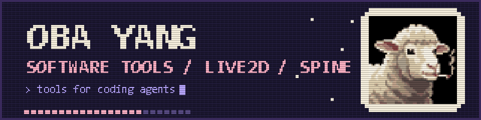

 

[**obayang.com**](https://obayang.com) · [Hire me](https://obayang.com/#contact) · **English** · [繁體中文](#繁體中文)

### About me

- I build **developer tools**: CLIs, file viewers, editors and converters
- I make tools for **running AI coding agents in parallel**
- I work a lot with **Spine** skeletal animation and **Live2D / VTuber** models
- Most of my web tools run **offline in your browser**, so nothing you paste leaves your machine

### Featured projects

<table>
<tr>
<td width="50%" valign="top">

#### [slotenv](https://github.com/zzoraemon043/slotenv)
Run parallel coding agents without collisions: each git worktree gets its own ports, `.env` and database. No containers, works with any agent.

`TypeScript` `CLI` · [**npm**](https://www.npmjs.com/package/nocollide)

</td>
<td width="50%" valign="top">

#### [Spine Asset Inspector](https://github.com/zzoraemon043/spine-asset-inspector)
Preview, debug and export Spine 2D animations in the browser: mix lab, skins, debug overlays, atlas unpacking, PNG / sprite sheet / WebM export.

`React` `WebGL` · [**Live demo**](https://zzoraemon043.github.io/spine-asset-inspector/)

</td>
</tr>
<tr>
<td width="50%" valign="top">

#### [hexsleuth](https://github.com/zzoraemon043/hexsleuth)
Hand an AI agent a few sample files and get back the format: a specification, a Kaitai Struct definition, a parser and tests.

`TypeScript` `MCP` · [**npm**](https://www.npmjs.com/package/hexsleuth)

</td>
<td width="50%" valign="top">

#### [layerdesk](https://github.com/zzoraemon043/layerdesk)
Open a PSD in the browser, rearrange its layers and save it back. Includes a rigging check for Live2D and Spine.

`React` `Canvas` · [**Live demo**](https://zzoraemon043.github.io/layerdesk/)

</td>
</tr>
</table>

**More:**
[sqlpane](https://github.com/zzoraemon043/sqlpane) (SQL on CSV / Excel / Parquet / SQLite, offline) ·
[zhtw-guard](https://github.com/zzoraemon043/zhtw-guard) (Traditional Chinese linter) ·
[Dev Workbench](https://github.com/zzoraemon043/dev-workbench) (JSON, Regex, JWT, Diff in one tab) ·
[Web Mock Studio](https://github.com/zzoraemon043/web-mock-studio) (mock APIs with a Service Worker) ·
[opsleuth](https://github.com/zzoraemon043/opsleuth) (recover renumbered Lua opcodes)

### Open source contributions

28 merged pull requests, including:

- [playcanvas/engine#9798](https://github.com/playcanvas/engine/pull/9798): fix math.smoothstep and smootherstep when min is greater than max
- [duckdb/duckdb-node-neo#518](https://github.com/duckdb/duckdb-node-neo/pull/518): return one empty column per column for empty query results
- [dexie/Dexie.js#2353](https://github.com/dexie/Dexie.js/pull/2353): ignore errors from aborted liveQuery runs after unsubscribe
- [CherryHQ/cherry-studio#21954](https://github.com/CherryHQ/cherry-studio/pull/21954): stop CJK text files from being detected as binary
- [gkjohnson/three-mesh-bvh#934](https://github.com/gkjohnson/three-mesh-bvh/pull/934): fix closestPointToSegment for segments crossing the triangle
- [gpac/mp4box.js#572](https://github.com/gpac/mp4box.js/pull/572): stop seek from throwing on a track without samples

22 more

- [EasyLive2D/live2d-py#149](https://github.com/EasyLive2D/live2d-py/pull/149): fix a silent crash when a Live2D model's texture is missing (OpenGL backend)
- [Kitware/vtk-js#3687](https://github.com/Kitware/vtk-js/pull/3687): fix errors in the KeyboardCameraManipulator example
- [holistics/dbml#1009](https://github.com/holistics/dbml/pull/1009): keep the written order of index columns when parsing
- [ThatOpen/engine_components#835](https://github.com/ThatOpen/engine_components/pull/835): type FragmentsManager.init options correctly
- [ormar-orm/ormar#1865](https://github.com/ormar-orm/ormar/pull/1865): make get() after exclude() report multiple matches
- [greggman/twgl.js#246](https://github.com/greggman/twgl.js/pull/246): emit declare namespace for v3, m4 and primitives in the TypeScript definitions
- [pycollada/pycollada#166](https://github.com/pycollada/pycollada/pull/166): drop XML comments and processing instructions when parsing COLLADA files with lxml
- [dcmjs-org/dcmjs#610](https://github.com/dcmjs-org/dcmjs/pull/610): format DS numbers to 16 characters instead of cutting off the exponent
- [AlaSQL/alasql#2602](https://github.com/AlaSQL/alasql/pull/2602): key the statement cache on the SQL text instead of its hash
- [moeru-ai/airi#3026](https://github.com/moeru-ai/airi/pull/3026): load the Kokoro TTS model in the window that generates speech
- [mozman/ezdxf#1449](https://github.com/mozman/ezdxf/pull/1449): allow line breaks between CJK characters in MTEXT layout
- [gkjohnson/three-gpu-pathtracer#896](https://github.com/gkjohnson/three-gpu-pathtracer/pull/896): fix a ReferenceError when a scene is generated a second time
- [tortoise/tortoise-orm#2350](https://github.com/tortoise/tortoise-orm/pull/2350): keep auto_now values naive when use_tz is False
- [lelit/pglast#226](https://github.com/lelit/pglast/pull/226): include the libpg_query upb sources in the sdist
- [abey79/vpype#872](https://github.com/abey79/vpype/pull/872): fix the plotter unit length of the HP 7550A configuration
- [NyarchLinux/NyarchAssistant#169](https://github.com/NyarchLinux/NyarchAssistant/pull/169): fix Live2D and VRM model names cut short in the model list
- [qwersyk/Newelle#461](https://github.com/qwersyk/Newelle/pull/461): fix GGUF model names cut short in the llama.cpp model lists
- [oh-jon-paul/awesome-i18n#75](https://github.com/oh-jon-paul/awesome-i18n/pull/75): add zhtw-guard to the curated i18n tools list
- [AlaSQL/alasql#3076](https://github.com/AlaSQL/alasql/pull/3076): stop reusing a cached join index whose key reads a query parameter
- [harttle/liquidjs#999](https://github.com/harttle/liquidjs/pull/999): accept whitespace control on endraw and keep entities in escape_once
- [Salamek/cron-descriptor#122](https://github.com/Salamek/cron-descriptor/pull/122): describe # and L day-of-week items separately from plain weekdays in a mixed list
- [bradymholt/cRonstrue#445](https://github.com/bradymholt/cRonstrue/pull/445): describe plain weekdays and # weekdays separately in a day-of-week list
- [dbcli/mycli#2449](https://github.com/dbcli/mycli/pull/2449): keep $1 from matching the start of $10 and above in favorite query arguments
- [i18next/i18next-cli#332](https://github.com/i18next/i18next-cli/pull/332): match whole option names when finding count and context in nested translations
- [iTowns/itowns#2868](https://github.com/iTowns/itowns/pull/2868): clear tile update state and links when a geometry layer is deleted

<!-- 暫時隱藏
### Special contributions

Private repositories. For complete AICL/達楓/青蘋果 (repair in progress) server and launcher source code, feel free to contact me.

- [vtxe02023274/aicl-v113#12](https://github.com/vtxe02023274/aicl-v113/pull/12) (merged): fix compile errors in the server submodules (86 errors, lost generics and final reassignments)
- [vtxe02023274/aicl-v113#13](https://github.com/vtxe02023274/aicl-v113/pull/13) (merged): fix compile errors in server/ui (71 errors, lost generics and a shadowed package name)
- [vtxe02023274/aicl-v113#14](https://github.com/vtxe02023274/aicl-v113/pull/14) (merged): fix compile errors in scripting and database (64 errors)
- [vtxe02023274/aicl-v113#15](https://github.com/vtxe02023274/aicl-v113/pull/15) (merged): fix compile errors in aicl, Apple, acemod and JsonAndHttps (69 errors)
- [vtxe02023274/aicl-v113#16](https://github.com/vtxe02023274/aicl-v113/pull/16) (merged): fix compile errors in tools (124 errors, including the expression tokenizer and packet builders)
- [vtxe02023274/aicl-v113#28](https://github.com/vtxe02023274/aicl-v113/pull/28) (merged): drop 5 stray javax/annotation classes and the last warnings; the class list now matches the original build
- [vtxe02023274/aicl-v113#29](https://github.com/vtxe02023274/aicl-v113/pull/29) (merged): trace the bugs kept from the original build back to the original bytecode
- [vtxe02023274/aicl-v113#31](https://github.com/vtxe02023274/aicl-v113/pull/31) (merged): add a 43-item in-game test checklist against the original server
- [vtxe02023274/VanitasShield-v113#4](https://github.com/vtxe02023274/VanitasShield-v113/pull/4) (merged): ijl15 proxy DLL forwarding all 6 exports to the genuine library by ordinal
- [vtxe02023274/VanitasShield-v113#5](https://github.com/vtxe02023274/VanitasShield-v113/pull/5) (merged): API hook framework on Microsoft Detours with install/remove in one transaction and a log file
- [vtxe02023274/VanitasShield-v113#6](https://github.com/vtxe02023274/VanitasShield-v113/pull/6) (merged): verify the rebuilt launcher against the original in 5 scenarios and fix a message mismatch
-->

### Tech stack

---

## 繁體中文

開發者工具、AI 寫程式代理的平行開發工具，以及 Spine／Live2D 相關的離線網頁工具。開放接案，服務與價格請見 [obayang.com](https://obayang.com)。

| 專案 | 說明 |
|---|---|
| [slotenv](https://github.com/zzoraemon043/slotenv) | 同時跑多個 AI 寫程式代理不打架：每個 git worktree 有自己的埠、.env 與資料庫，不用容器（[npm](https://www.npmjs.com/package/nocollide)） |
| [Spine Asset Inspector](https://github.com/zzoraemon043/spine-asset-inspector) | 在瀏覽器檢視、除錯、匯出 Spine 動畫（[線上試用](https://zzoraemon043.github.io/spine-asset-inspector/)） |
| [hexsleuth](https://github.com/zzoraemon043/hexsleuth) | 讓 AI 從樣本檔推導二進位檔案格式，產出規格書、解析程式與測試（[npm](https://www.npmjs.com/package/hexsleuth)） |
| [layerdesk](https://github.com/zzoraemon043/layerdesk) | 在瀏覽器整理 PSD 圖層並存回，檢查 Live2D／Spine 拆件問題（[線上試用](https://zzoraemon043.github.io/layerdesk/)） |

其他作品：sqlpane、zhtw-guard、Dev Workbench、Web Mock Studio、opsleuth（說明見上方英文區）。已有 25 個 PR 合併進 PlayCanvas、DuckDB、Dexie、Cherry Studio 等開源專案。

<!-- 暫時隱藏
### 特殊貢獻

私人倉庫，如需 AICL/達楓/青蘋果 完整端口及登入器源碼，可聯繫我

- [vtxe02023274/aicl-v113#12](https://github.com/vtxe02023274/aicl-v113/pull/12)（已合併）：修正 server 子模組編譯錯誤（86 個，泛型遺失與 final 變數重新指派）
- [vtxe02023274/aicl-v113#13](https://github.com/vtxe02023274/aicl-v113/pull/13)（已合併）：修正 server/ui 編譯錯誤（71 個，泛型遺失與套件名被同名欄位遮蔽）
- [vtxe02023274/aicl-v113#14](https://github.com/vtxe02023274/aicl-v113/pull/14)（已合併）：修正 scripting、database 編譯錯誤（64 個）
- [vtxe02023274/aicl-v113#15](https://github.com/vtxe02023274/aicl-v113/pull/15)（已合併）：修正 aicl、Apple、acemod、JsonAndHttps 編譯錯誤（69 個）
- [vtxe02023274/aicl-v113#16](https://github.com/vtxe02023274/aicl-v113/pull/16)（已合併）：修正 tools 編譯錯誤（124 個，含運算式解析器與封包組裝）
- [vtxe02023274/aicl-v113#28](https://github.com/vtxe02023274/aicl-v113/pull/28)（已合併）：移除多出的 5 個 javax/annotation 類別並清掉警告，類別清單與原版完全一致
- [vtxe02023274/aicl-v113#29](https://github.com/vtxe02023274/aicl-v113/pull/29)（已合併）：比對原版位元組碼，確認保留下來的原有問題來源
- [vtxe02023274/aicl-v113#31](https://github.com/vtxe02023274/aicl-v113/pull/31)（已合併）：整理與原版對照的 43 項實機測試清單
- [vtxe02023274/VanitasShield-v113#4](https://github.com/vtxe02023274/VanitasShield-v113/pull/4)（已合併）：ijl15 代理 DLL，6 個匯出依序號轉給正版函式庫
- [vtxe02023274/VanitasShield-v113#5](https://github.com/vtxe02023274/VanitasShield-v113/pull/5)（已合併）：以 Microsoft Detours 實作的 API 掛鉤框架，一次交易安裝與還原，附日誌
- [vtxe02023274/VanitasShield-v113#6](https://github.com/vtxe02023274/VanitasShield-v113/pull/6)（已合併）：重建的登入器與原版逐項比對 5 種情境，修正一則訊息差異
-->

如果有幫到你，歡迎點個星星 · If something here helps you, a star is always appreciated

